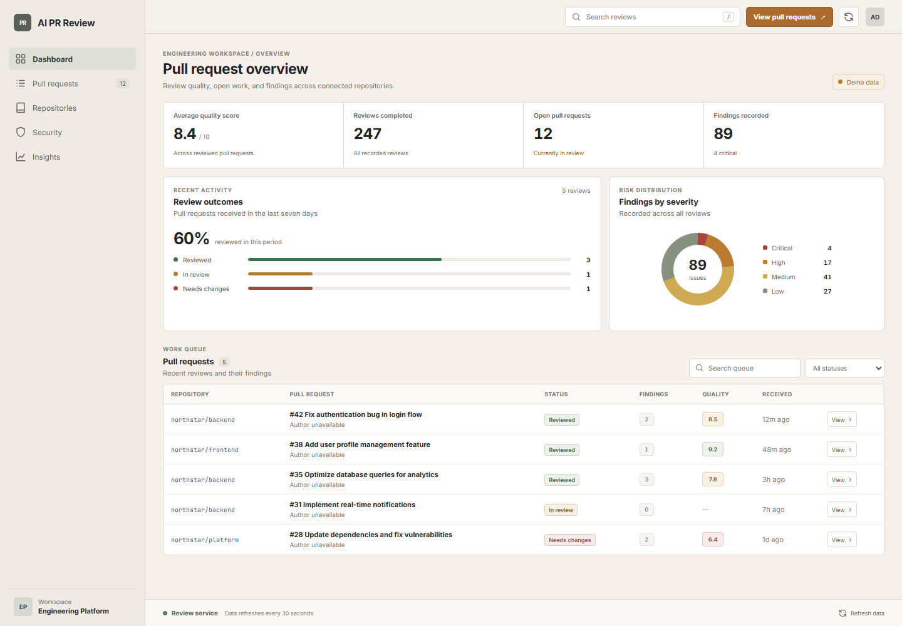

# AI PR Review

## Overview

AI PR Review is an AI-powered pull request review platform that helps engineering teams identify bugs, security risks, performance issues, architectural concerns, and code quality violations before merge.

The service receives GitHub pull-request webhooks, processes review work asynchronously, stores findings, and publishes review comments back to GitHub. The web workspace presents recent reviews, quality scores, review status, and findings by severity.

## Product Preview



*The dashboard shown with deterministic demonstration reviews.*

## Demo

Try the complete review workflow locally with Docker Compose. The demo uses a deterministic provider, so GitHub App credentials and AI provider keys are not required. Docker Compose must be installed.

In PowerShell, generate local credentials and start the demo:

```powershell
$env:CODESAGE_DEMO_POSTGRES_USER = "reviewdemo"
$env:CODESAGE_DEMO_POSTGRES_PASSWORD = (New-Guid).Guid
$env:CODESAGE_DEMO_RABBITMQ_USERNAME = "reviewdemo"
$env:CODESAGE_DEMO_RABBITMQ_PASSWORD = (New-Guid).Guid
docker compose -f docker-compose.demo.yml up -d --build --wait
```

Create a sample pull-request review and inspect the results:

```powershell
curl.exe --fail -X POST http://localhost:8080/api/demo/reviews
curl.exe --fail http://localhost:8080/api/reviews/recent
```

Open the dashboard at <http://localhost:8088>. The review appears in the queue with its quality score and findings. Stop the demo and remove its containers and database volume with:

```powershell
docker compose -f docker-compose.demo.yml down -v
```

## Key Capabilities

- Verify GitHub webhook signatures with HMAC-SHA256.
- Queue review jobs through RabbitMQ with retry and dead-letter handling.
- Analyze pull-request diffs using configured OpenAI or Claude providers, with a deterministic provider for local demonstrations and tests.
- Detect and report structured findings with severity, category, file location, and suggested improvements.
- Prevent duplicate reviews for a repository and pull-request number.
- Persist reviews and findings in PostgreSQL.
- Publish review comments to GitHub and expose service metrics through Micrometer and Prometheus.
- Inspect review activity, findings, and quality scores in the React workspace.

## How Review Engine Works

1. GitHub sends a pull-request event to the webhook endpoint.
2. The service verifies the webhook signature and queues supported events.
3. A review worker checks for an existing review and fetches the pull-request diff.
4. An available analysis provider returns a structured summary, quality score, and findings.
5. The service stores the result and posts a review comment to GitHub.
6. The dashboard reads aggregate statistics and recent review records from the API.

## Pull Request Analysis

Reviews focus on issues visible in the submitted diff. The analysis result can include severity, issue type, file path, line number, a concise explanation, and a suggested improvement. Provider prompts treat repository content as untrusted input.

The current dashboard shows aggregate review statistics and the recent review queue. It does not expose a diff viewer or claim complete repository-wide analysis.

## Security Analysis

The review engine can report security-related issues identified in a pull-request diff. GitHub webhook signatures are validated, production Compose requires database and queue credentials, and the service returns sanitized external-service errors. CI includes dependency and secret scanning.

This is not a dedicated secrets scanner or software-composition-analysis service. Findings depend on the diff and the configured analysis provider; review output should be validated by engineers before merge.

## Quality Gates

Use the repository's existing checks before merging:

```powershell
cd backend
..\mvnw.cmd --batch-mode clean verify

cd ..\frontend
npm ci
npm run lint
npm test
npm run build
```

Continuous integration also runs dependency, secret, CodeQL, and container-demo checks.

## Architecture

- **Backend:** Java 17 and Spring Boot expose review endpoints, validate webhooks, coordinate providers, persist results, and publish metrics.
- **Queue:** RabbitMQ separates webhook intake from review execution and routes failed work through retry and dead-letter queues.
- **Storage:** PostgreSQL stores reviews, findings, and webhook-delivery state.
- **Integrations:** GitHub operations and AI providers are isolated behind backend interfaces.
- **Frontend:** React and Vite provide the review dashboard and pull-request detail panel.

See [the architecture guide](docs/architecture.md), [GitHub integration](docs/github-integration.md), and [deployment guide](docs/deployment.md) for implementation and operating details.

## Installation

Requirements: Java 17, Node.js 22, Docker Compose, and Git. Maven is available through the included wrapper.

Clone the repository from your organization's Git host, then configure the environment variables described below. Docker Compose can run the complete local demonstration stack without provider credentials.

## Configuration

Production Compose requires `POSTGRES_PASSWORD`, `RABBITMQ_USERNAME`, and `RABBITMQ_PASSWORD`. Set `OPENAI_API_KEY` or `CLAUDE_API_KEY` to enable a remote provider. Configure GitHub App credentials and `GITHUB_WEBHOOK_SECRET` to process real repository events.

The service currently retains the established `CODESAGE_*` environment variables and `codesage.*` Spring properties for deployment compatibility. See [.env.example](.env.example) and [the integration guide](docs/github-integration.md) for the full list and setup details. Keep `GITHUB_WEBHOOK_SIGNATURE_REQUIRED=true` and `CODESAGE_DEMO_ENABLED=false` in production.

## Running Locally

For frontend/backend development without the Docker demo, start the backend in its development profile:

```powershell
cd backend
..\mvnw.cmd spring-boot:run -Dspring-boot.run.profiles=dev
```

In another terminal, start the frontend:

```powershell
cd frontend
npm ci
npm run dev
```

The development workspace is served at <http://localhost:5173>. The frontend API base URL can be set with `VITE_API_URL`.

## Docker Deployment

The production Compose file builds the API and frontend alongside PostgreSQL and RabbitMQ:

```powershell
docker compose up -d --build
```

Supply the required credentials through the process environment or a local, untracked `.env` file. Demo mode is disabled in this deployment. Review [the deployment guide](docs/deployment.md) for health checks, TLS, backups, and operational safeguards.

## Future Roadmap

- Add a file-level diff view for review findings.
- Expand the dashboard with time-based review and team effectiveness reporting.
- Add explicit security findings views for vulnerabilities, exposed secrets, and dependency risk.
- Add configurable repository quality gates and review policies.
- Add integration coverage for PostgreSQL and RabbitMQ using Testcontainers.

These are planned enhancements, not capabilities currently exposed by the application.

## Contributing

Contributions should preserve the webhook, API, database, queue, and provider contracts unless a change explicitly updates and tests them. Run the backend and frontend checks listed in [Quality Gates](#quality-gates), and see [CONTRIBUTING.md](CONTRIBUTING.md) for the contribution workflow.
